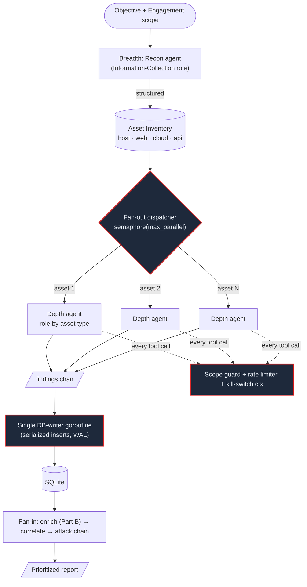
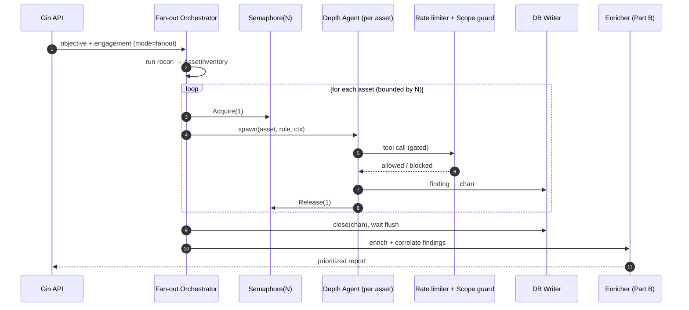
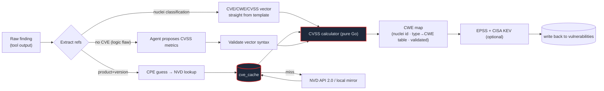

# Design — Concurrent Breadth+Depth Orchestration & CVE/CWE/CVSS Enrichment

> Status: **Implemented** · Owner: core · Scope: `internal/multiagent` (+ `internal/multiagent/fanout`), `internal/agent`, `internal/security`, `internal/database`, `internal/handler`, new `internal/enrich` (`cvss`/`cve`/`cwe`)
>
> As built: CVSS calculator `internal/enrich/cvss`; enricher `internal/enrich` (+ KEV/EPSS clients); DB columns + `cve_cache` + `migrateVulnerabilitiesTable()`; parallel tool calls via `agent.max_parallel_tools`; fan-out via request `orchestration: "fanout"` → `internal/multiagent/fanout`; per-host limiter `internal/security/ratelimit.go`; single-writer `internal/database/writer.go`; ranked report + `?sort=cvss`; write-time enrichment in the `record_vulnerability` tool and `POST /vulnerabilities/reenrich`.
> Related: [MULTI_AGENT_EINO.md](MULTI_AGENT_EINO.md) · [SRS_REPORT.md](SRS_REPORT.md)

## 1. Summary

Two capabilities, one pipeline:

- **Part A — Concurrent fan-out.** Assess a large attack surface *broadly* and drill into each asset *deeply*, **at the same time**, instead of today's strictly-serial agent. Pattern: **fan-out recon → bounded-parallel per-asset depth agents → fan-in correlation**.
- **Part B — CVE/CWE/CVSS enrichment.** Every finding is mapped to its **CVE(s)** and **CWE(s)** and carries a **deterministically calculated CVSS** base score (+ severity band), with optional EPSS/KEV prioritization. Enrichment is the first stage of fan-in, so breadth+depth output lands already scored and prioritized.

They connect: the depth workers produce raw findings; the fan-in stage **enriches** (CVE/CWE/CVSS) and **correlates** (attack chain) before the report.

### Goals
- Wide + deep concurrently, with a hard, configurable concurrency cap and ROE-safe rate limiting.
- Reproducible CVSS: the score is **computed in code from a vector**, never a number guessed by the LLM.
- Works **fully offline** (CVSS always; CVE via local mirror/cache), degrading gracefully.
- Additive — existing `single` / `deep` / `plan-execute` / `supervisor` modes untouched.

### Non-goals
- No change to the authorization model. Scope guard + kill-switch remain mandatory and now apply **per worker**.
- Not building our own CVE database; we cache NVD and optionally mirror its feed.

## 2. Current-state constraints (grounded in code)

| Constraint | Evidence | Consequence |
|---|---|---|
| Single-agent tool calls are **serial** | `for idx, toolCall := range choice.Message.ToolCalls` — [agent.go:560](../internal/agent/agent.go) | Multi-tool turns run one-at-a-time. |
| Multi-agent delegation is **serial**, nesting forbidden | no concurrency primitives in `internal/multiagent/eino_*`; [no_nested_task.go](../internal/multiagent/no_nested_task.go) | "Multi-agent" ≠ parallel today. |
| Batch queue is scheduling, not parallelism | [batch_task_manager.go](../internal/handler/batch_task_manager.go) | Queued targets run back-to-back. |
| Hard iteration ceiling | `agent.max_iterations: 120`, `tool_timeout_minutes: 30` — [config.example.yaml](../config.example.yaml) | A large surface exhausts the budget on recon before depth. |
| No concurrency knobs | none in `config.example.yaml` | Nothing to tune. |
| Findings have **no** CVE/CWE/CVSS | `Vulnerability` struct + table — [vulnerability.go:11](../internal/database/vulnerability.go), [database.go:185](../internal/database/database.go) | Severity is free-text, unscored, unprioritized. |
| Migrations exist as a pattern | `migrate*Table()` via `pragma_table_info` + `ALTER TABLE` — [database.go:388](../internal/database/database.go) | New columns follow this exact idiom. |

---

# Part A — Concurrent breadth + depth

## A.1 Target architecture



**Key idea:** breadth is one fast recon pass that emits a *structured inventory*; depth is **N concurrent agents**, one per asset, each a reuse of the existing single-agent runner with its own context and role. Concurrency is **bounded** (semaphore) and **rate-limited** (per host), so "wide and deep" never becomes a DoS.

## A.2 New components

| Component | Location (new/changed) | Responsibility |
|---|---|---|
| `AssetInventory` + `Asset` types | `internal/multiagent/fanout/inventory.go` (new) | Structured recon output: `{ID, Type, Value, Ports, Services, Metadata}`. |
| `record_asset` tool | `tools/record-asset.yaml` + executor hook | Recon agent emits assets as structured rows (not prose). Fallback: parse recon tool JSON. |
| Fan-out orchestrator | `internal/multiagent/fanout/orchestrator.go` (new) | `errgroup` + `semaphore.Weighted`; one depth agent per asset; fan-in trigger. |
| Depth worker | reuses [eino_single_runner.go](../internal/multiagent/eino_single_runner.go) / [agent.go](../internal/agent/agent.go) | Per-asset ReAct loop, role auto-selected, own `sub_agent_max_iterations`. |
| DB-writer goroutine | `internal/database/writer.go` (new) | Consumes `chan Finding`, serializes inserts; WAL + `_busy_timeout`. |
| Per-engagement rate limiter | `internal/security/ratelimit.go` (new) | `golang.org/x/time/rate` keyed by host; enforced in executor before exec. |
| Mode wiring | [runner.go](../internal/multiagent/runner.go), [multi_agent.go](../internal/handler/multi_agent.go) | New `agent_mode: "fanout"`. |

## A.3 Concurrency & safety (the parts that bite)

- **Bounded pool.** `errgroup.WithContext(ctx)` + `semaphore.Weighted(max_parallel_assets)`. Workers `Acquire(1)` before spawning, `Release` on done. Default **5**.
- **SQLite under concurrency.** modernc SQLite will throw `database is locked` with N writers. Fix = **single writer goroutine** fed by a buffered channel + `PRAGMA journal_mode=WAL` + `PRAGMA busy_timeout=5000`. Workers never write directly.
- **Kill-switch.** Must cancel the **shared errgroup ctx** → all workers stop. Scope guard still gates each individual call ([scope/matcher.go](../internal/security/scope/matcher.go)).
- **ROE rate limiting.** Concurrent agents multiply real traffic. A per-host `rate.Limiter` (e.g. 2 rps) caps aggregate load regardless of worker count — prevents accidental DoS / WAF-tripping and honors engagement limits.
- **Budget isolation.** Each depth agent gets its own `asset_depth_max_iterations` so one noisy asset can't starve the rest (vs. today's single global 120).

## A.4 Fan-out sequence



## A.5 Config additions

```yaml
multi_agent:
  fanout:
    enabled: true
    max_parallel_assets: 5          # hard concurrency cap
    per_host_rate_limit_rps: 2      # ROE-safe aggregate load per host
    asset_depth_max_iterations: 60  # budget per depth agent
    recon_role: "Information-Collection"
    depth_role_map:                 # asset type → role
      web:   "Web-Application-Scanning"
      host:  "Penetration-Testing"
      cloud: "Cloud-Security-Audit"
      api:   "API-Security-Testing"
```

---

# Part B — CVE / CWE / CVSS enrichment

## B.1 Principle: scores are *calculated*, not guessed

The CVSS number is always produced by a **pure-Go calculator from a vector string** (FIRST CVSS v3.1 spec; v4.0 optional). Where a finding has no published CVE, the agent proposes the **metrics** (AV/AC/PR/UI/S/C/I/A) and code computes the score — reproducible and auditable, never an LLM-invented float.

## B.2 Data model changes

New columns on `vulnerabilities` (via `migrateVulnerabilitiesTable()`, same idiom as [database.go:388](../internal/database/database.go)):

| Column | Type | Notes |
|---|---|---|
| `cve_ids` | TEXT | JSON array, e.g. `["CVE-2021-44228"]` |
| `cwe_ids` | TEXT | JSON array, e.g. `["CWE-89"]` |
| `cvss_version` | TEXT | `3.1` / `4.0` |
| `cvss_vector` | TEXT | e.g. `CVSS:3.1/AV:N/AC:L/PR:N/UI:N/S:U/C:H/I:H/A:H` |
| `cvss_base_score` | REAL | 0.0–10.0, computed |
| `cvss_severity` | TEXT | derived band (None/Low/Medium/High/Critical) |
| `epss_score` | REAL | optional, 0–1 |
| `epss_percentile` | REAL | optional |
| `kev` | INTEGER | CISA Known-Exploited flag (0/1) |

New table **`cve_cache`** (local, reproducible, offline-friendly):

```sql
CREATE TABLE IF NOT EXISTS cve_cache (
  cve_id TEXT PRIMARY KEY,
  description TEXT,
  cvss_version TEXT,
  cvss_vector TEXT,
  cvss_score REAL,
  cwe_ids TEXT,          -- JSON array
  epss_score REAL,
  kev INTEGER DEFAULT 0,
  published DATETIME,
  modified DATETIME,
  source TEXT,           -- nvd | local_mirror | nuclei
  fetched_at DATETIME NOT NULL DEFAULT CURRENT_TIMESTAMP
);
```

`cvss_base_score` gets an index for severity sorting in the dashboard/report.

## B.3 Enrichment pipeline



**Source precedence** (highest confidence first):
1. **Structured tool metadata** — `nuclei` JSON `classification` already carries `cve-id`, `cwe-id`, `cvss-metrics` (vector), `cvss-score`. Near-free for the biggest finding source. Same for `trivy`, `wpscan`.
2. **Product+version → CPE → NVD** — for version-based findings; cache in `cve_cache`.
3. **Agent-proposed vector** — for findings with no CVE (business logic, chained issues). LLM picks metrics, calculator computes score.

**CWE mapping:** nuclei `cwe-id` → else a seeded `type → CWE` table (`knowledge_base/cwe_map.yaml`: SQLi→CWE-89, XSS→CWE-79, SSRF→CWE-918, …) → else LLM-assisted, validated against the official CWE id list.

## B.4 CVSS calculator (offline, deterministic)

New package `internal/enrich/cvss`:
- `ParseVector(s) (Vector, error)` — strict syntax validation.
- `BaseScore(v) (float64, Severity)` — CVSS v3.1 base: compute ISS → Impact (scope-aware) → Exploitability → base with the spec's `roundup`. v4.0 behind a flag.
- `Band(score) Severity` — 0 None · 0.1–3.9 Low · 4.0–6.9 Medium · 7.0–8.9 High · 9.0–10 Critical.

No network, no data files — the formula is self-contained, so **CVSS always works offline**. Table-driven unit tests from FIRST's published examples lock correctness.

## B.5 CVE source & offline posture

New package `internal/enrich/cve`:
- `source: nvd` — NVD REST 2.0 (optional `${NVD_API_KEY}` raises the rate limit); results cached in `cve_cache` with TTL.
- `source: local_mirror` — point at a downloaded NVD JSON feed dir for air-gapped engagements.
- `source: off` — skip CVE lookups; CVSS still computed from vectors.
- Respects the HTTPS-enforced outbound policy already in config.

```yaml
enrichment:
  cvss:
    default_version: "3.1"      # "4.0" optional
  cve:
    enabled: true
    source: "nvd"               # nvd | local_mirror | off
    nvd_api_key: ${NVD_API_KEY}
    local_mirror_path: ""
    cache_ttl_hours: 168
  cwe:
    map_file: "knowledge_base/cwe_map.yaml"
  epss: { enabled: false }
  kev:  { enabled: true }        # CISA Known Exploited Vulnerabilities
```

## B.6 Hook points
- **Write-time:** the agent's finding-recording path ([handler/vulnerability.go](../internal/handler/vulnerability.go)) calls the enricher so every finding lands scored.
- **Batch re-enrich:** admin endpoint to re-run enrichment over existing findings (e.g. after a KEV/EPSS refresh).
- **Report:** [report.go](../internal/handler/report.go) gains CVE/CWE/CVSS columns and sorts by `cvss_base_score` (then EPSS/KEV) for real prioritization. Attack-chain `risk_score` can be seeded from CVSS.

---

## 3. Phased delivery plan

| Phase | Deliverable | Touches | Dep |
|---|---|---|---|
| **P0** | CVSS calculator (v3.1, offline) + schema migration + report shows computed score/band | `internal/enrich/cvss`, `database`, `handler/report` | — |
| **P1** | CVE/CWE extraction from nuclei/trivy/wpscan + `cve_cache` + NVD client w/ offline fallback; enrich at write-time | `internal/enrich/cve`,`cwe`, `handler/vulnerability` | P0 |
| **P2** | *Quick win:* parallel multi-tool-call execution inside the single agent (semaphore-bounded) | `internal/agent/agent.go` | — |
| **P3** | Full `fanout` mode: AssetInventory + bounded worker pool + DB-writer goroutine + WAL + per-host rate limiter + kill-switch ctx | `internal/multiagent/fanout`, `database/writer`, `security/ratelimit` | P2 |
| **P4** | Fan-in correlation + EPSS/KEV prioritization + CVSS-ranked report & dashboard | `attackchain`, `handler/report`, `web` | P1,P3 |

P0+P1 ship value with zero concurrency risk. P2 is a small, immediate speedup. P3 is the big architectural piece. P4 ties it together.

## 4. Evaluation hooks (ties to `research/`)
- **Concurrency:** wall-clock + tool-invocations for a fixed multi-asset target, `single` vs `fanout` at N∈{1,3,5,10}; watch for lock contention and false-positive rate drift.
- **Scoring:** CVSS calculator vs FIRST reference vectors (exact match); CVE/CWE mapping precision/recall on a labeled finding set.

## 5. Risks & open decisions
1. **CVSS version** — recommend **3.1 primary**, 4.0 optional (most tooling emits 3.1 vectors). *Decision needed.*
2. **No-CVE scoring** — recommend **LLM proposes metrics → code computes** (reproducible). Alternative: static type→vector heuristic. *Decision needed.*
3. **Concurrency default** — recommend **5 + 2 rps/host**. *Decision needed.*
4. **Offline CVE** — recommend ship **API+cache**, document `local_mirror` for air-gapped. *Decision needed.*
5. SQLite writer is a hard correctness dependency for P3 — must land before parallel writes.

## 6. Test strategy
- `cvss`: table tests from FIRST examples (exact score match).
- `cve`: cache hit/miss, TTL, offline fallback, CPE match precision.
- `fanout`: race detector (`go test -race`); kill-switch cancels all workers mid-run; scope guard blocks an out-of-scope asset without killing the pool; writer serializes under N writers.
